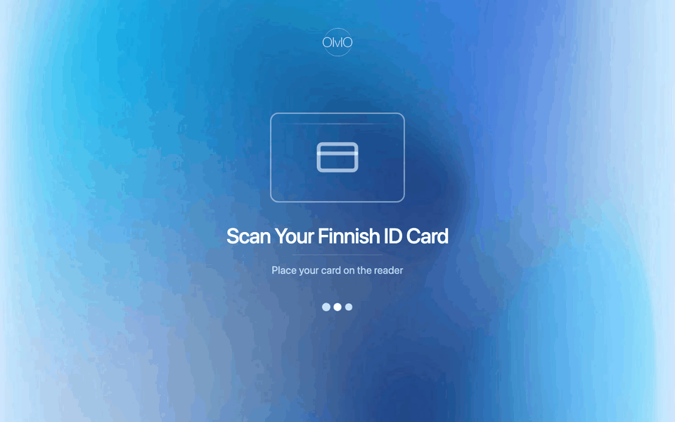
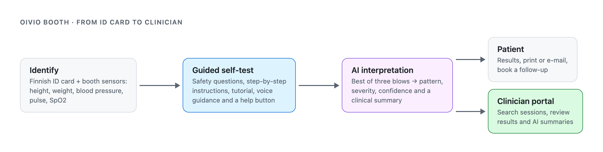
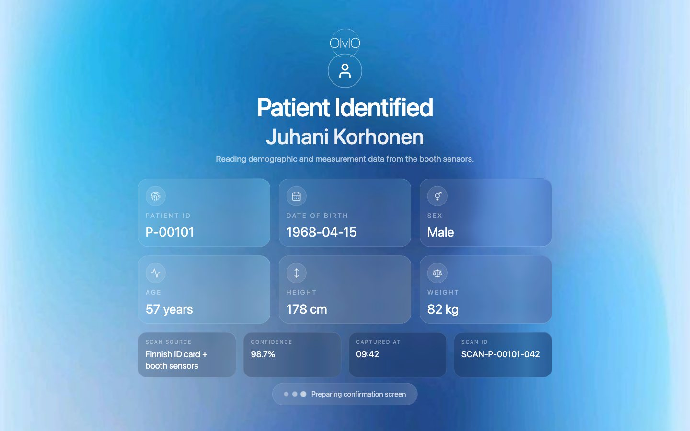
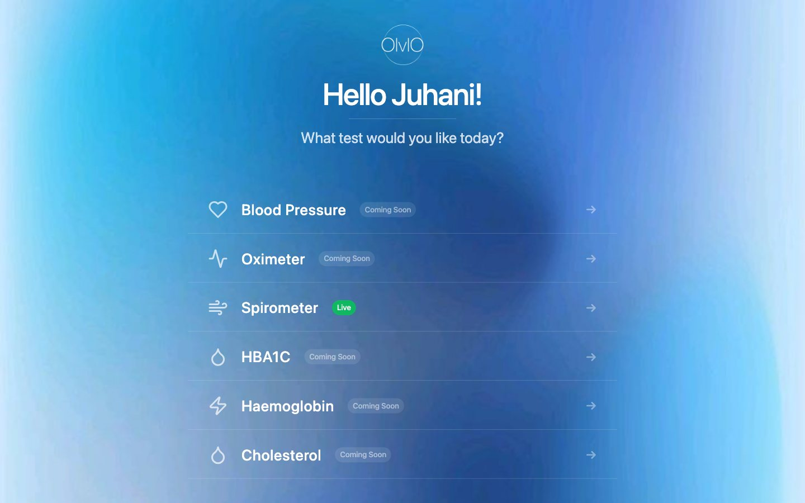
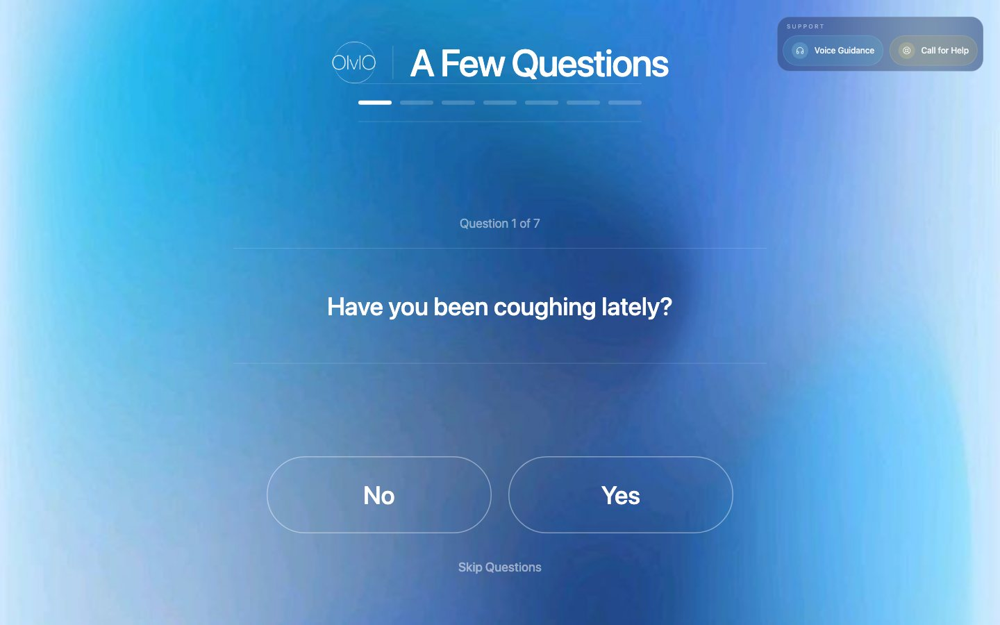
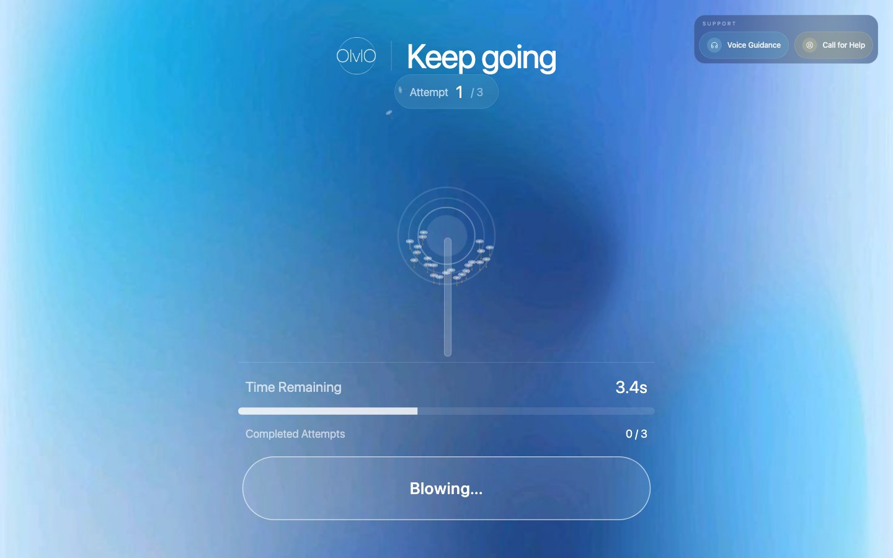
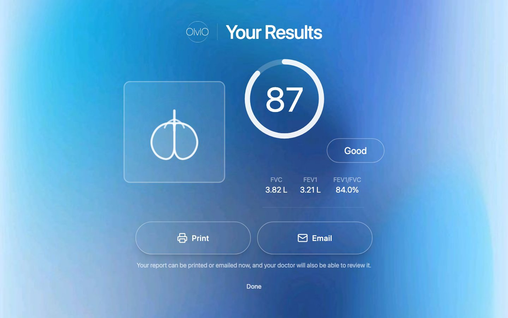
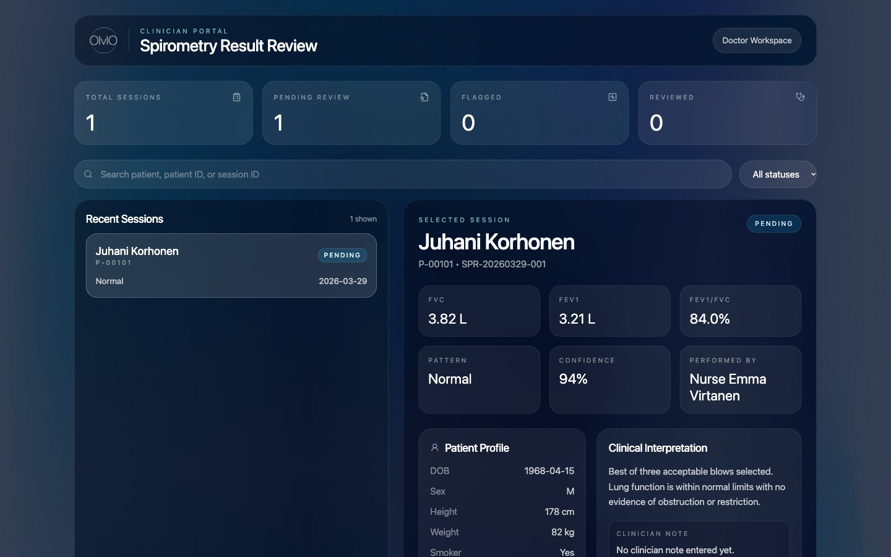

# Oivio: AI-Assisted Medical Test Booth

**A self-service health check booth where a patient identifies with their ID card, runs a spirometry (lung function) test guided step by step by the booth, and gets an AI-interpreted result that a clinician reviews remotely.** A hackathon prototype of the booth's touchscreen UI and clinician portal.

**[▶ Try the live demo](https://eeroklen-lang.github.io/AI-Assisted-Medical-Test-Booth/)** (best in a full-screen desktop browser; the demo patient is filled in automatically)



## Background

Spirometry is the standard test for chronic obstructive pulmonary disease (COPD), one of the [leading causes of death worldwide](https://www.who.int/news-room/fact-sheets/detail/chronic-obstructive-pulmonary-disease-(copd)). The test itself takes minutes, but it normally needs a booked appointment and a trained nurse to coach the patient through the forced exhalation and check that the blows are acceptable. As a result, many people are tested late or not at all.

## Idea

Move routine screening tests out of the appointment book and into an **automated booth**, for example in a pharmacy or a health centre lobby, with the clinician in the loop remotely:

- **Identify and measure.** The patient taps their Finnish ID card. The booth fills in their details and its sensors measure height, weight, blood pressure, pulse and SpO2. The patient only confirms.
- **Guide the test instead of a nurse.** Safety questions come first, and answers that need a professional stop the test and call staff. Then come preparation steps (sanitise, mouthpiece, nose clip), a tutorial and a live test screen with encouragement and three attempts. Voice guidance and a *Call for Help* button stay on screen throughout the test.
- **Interpret with AI, decide with a clinician.** The best of three blows is analysed into FVC, FEV1 and FEV1/FVC, a pattern, a severity, a confidence score and a written summary. The patient sees a simple result and can book a follow-up. The clinician reviews the session, measurements and AI summary in a separate portal.
- **One booth, many tests.** Spirometry is the first test. Blood pressure, oximetry, HbA1c, haemoglobin and cholesterol are planned in the same flow.

<picture>
  <source media="(prefers-color-scheme: dark)" srcset="docs/images/flow-dark.png">
  
</picture>

## Screens

| | |
|---|---|
|  |  |
| **Patient identified.** ID card and booth sensor data | **Test selection.** Spirometry live, more tests coming |
|  |  |
| **Safety questions.** Answers that need a professional stop the test and call staff | **The test.** Blowing scatters the dandelion; three attempts |
|  |  |
| **Results.** Score, key values, print or e-mail | **Clinician portal.** Sessions, measurements and the AI summary |

## What is real and what is simulated

This is a front-end prototype. The booth hardware (ID card reader, sensors and spirometer) and the AI back end are simulated: a demo patient is "scanned", the test is a press-and-hold button, and results come from mock data. The API client (`src/app/lib/api.ts`) is written against a REST back end at `/api` (proxied to port 3001 in development) and falls back to demo data and browser storage when that back end isn't running, as on GitHub Pages.

The UI is designed for a large 1920×1200 kiosk touchscreen. On smaller screens the whole canvas is scaled to fit, so it looks the same on a laptop, just smaller.

## Tech stack

- **React 18**, TypeScript, **Vite 6**
- **Tailwind CSS 4**, **Motion** for animation, shadcn/ui (Radix) components, lucide icons
- **React Router 7** (hash router, for GitHub Pages)
- Designed in **Figma Make** ([design file](https://www.figma.com/design/AUGFGAcOmomORgivQE5REC/Medical-app-screen-design)) and developed further in code
- Deployed to **GitHub Pages** with GitHub Actions

`SpirometryBooth.jsx` in the repository root is an earlier single-file prototype of the test and result views, with flow-volume curves drawn in Recharts.

## Running locally

```bash
npm install
npm run dev
```

Then open the URL Vite prints, ending in `/AI-Assisted-Medical-Test-Booth/`. The flow starts from the ID card scan and moves on by itself; the clinician portal is at `#/clinician`.

## Credits

Built at a hackathon in spring 2026. UI components from [shadcn/ui](https://ui.shadcn.com/) (MIT) and photos from [Unsplash](https://unsplash.com); see [ATTRIBUTIONS.md](ATTRIBUTIONS.md).
